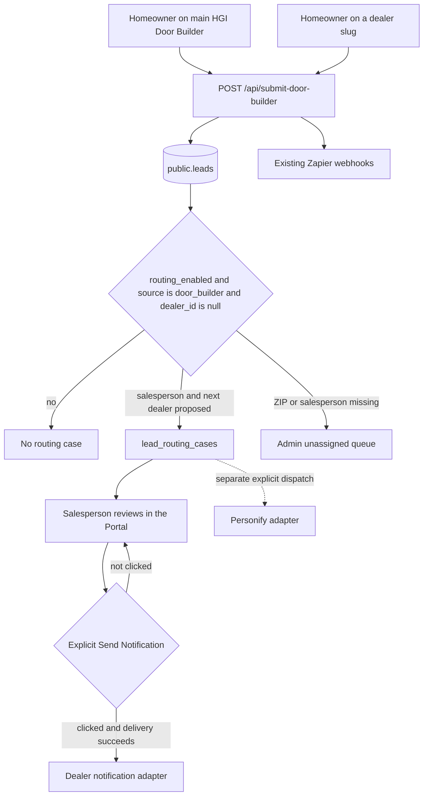

# ZIP lead routing architecture

Routing is a Portal concern. Door Builder keeps inserting `public.leads` and forwarding to Zapier. The Portal trigger classifies the new row. Notification adapters run only when a Portal API call is made and both the environment flag and the database switch allow it.

The dotted Personify step is not part of the insert. Nothing in the trigger calls Personify, Zapier, SMTP, or the dealer webhook.

## Gates

| Gate | Default | What it allows |
| --- | --- | --- |
| `lead_routing_settings.routing_enabled` | false | Trigger may create cases. Save and approval functions may write. |
| `LEAD_ROUTING_ENABLED` | unset, treated as false | Portal API may call those functions. |
| `PERSONIFY_NOTIFICATIONS_MODE` | `disabled` | `dry_run` records a rehearsal. `live` calls the Conversations API only when a private integration token is present. |
| `DEALER_NOTIFICATIONS_MODE` | `disabled` | `dry_run` records a rehearsal and does not advance rotation. `live` posts to `DEALER_NOTIFICATION_WEBHOOK_URL` when that URL is https and is not `hooks.zapier.com`. |
| Database `personify_mode` and `dealer_notifications_mode` | `disabled` | Must match the environment mode or the API refuses before it claims a send. |

Door Builder previews have no preview-only switch and write to the same Supabase project as production. They do not call `/api/lead-routing`. The trigger creates no notification row. A Vercel preview of this Portal therefore cannot send a salesperson or dealer notification unless someone sets the flags, which this change does not do.

## Access

Home Guard admins read every routing row. An active salesperson reads only cases assigned to them, the lead on that case, and the one proposed dealer. Inactive salespeople lose that read. Authenticated clients have no insert, update, or delete grant on the new tables. Writes go through service-role functions after the API has identified the signed-in user.

## Idempotent dealer send

`Send Notification` locks the case, checks the proposed dealer is still active, and claims one attempt whose key is `dealer-email:{leadId}:{dealerId}`. A second click while that attempt is sending gets `in_progress`. A failure keeps the same dealer and the same key. Success is the only event that moves the ZIP rotation pointer. A later success call for the same attempt returns `already_complete` and does not move the pointer again.
